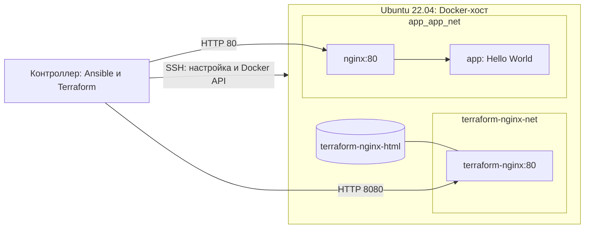
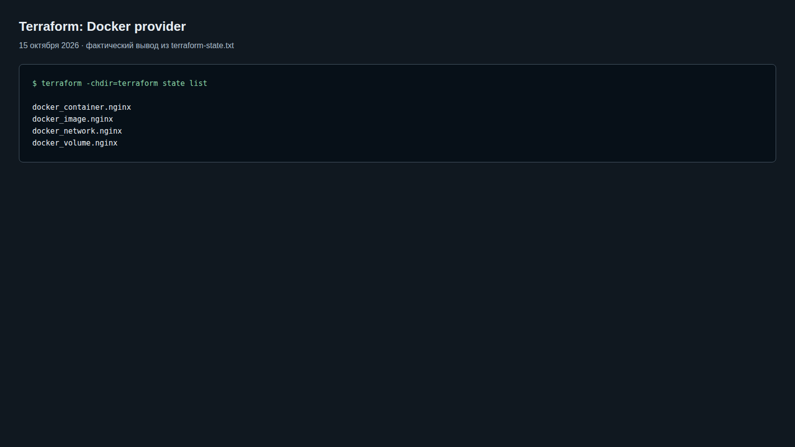
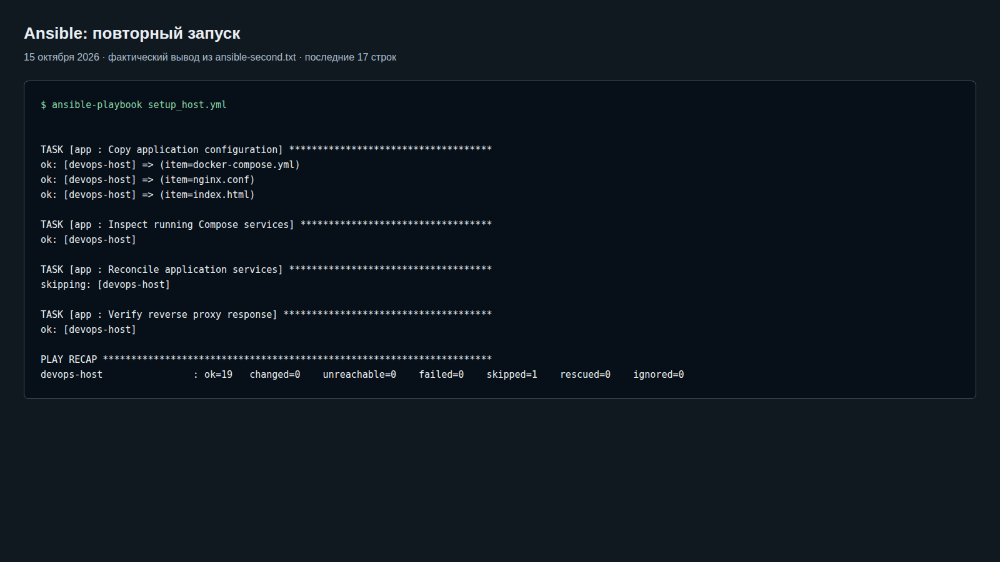
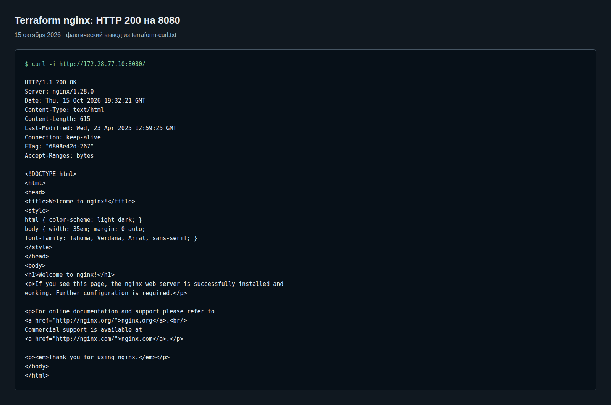
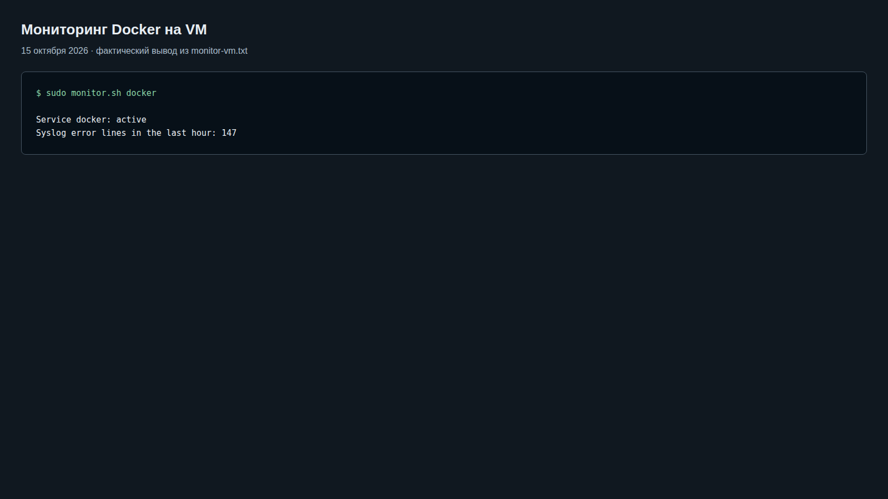
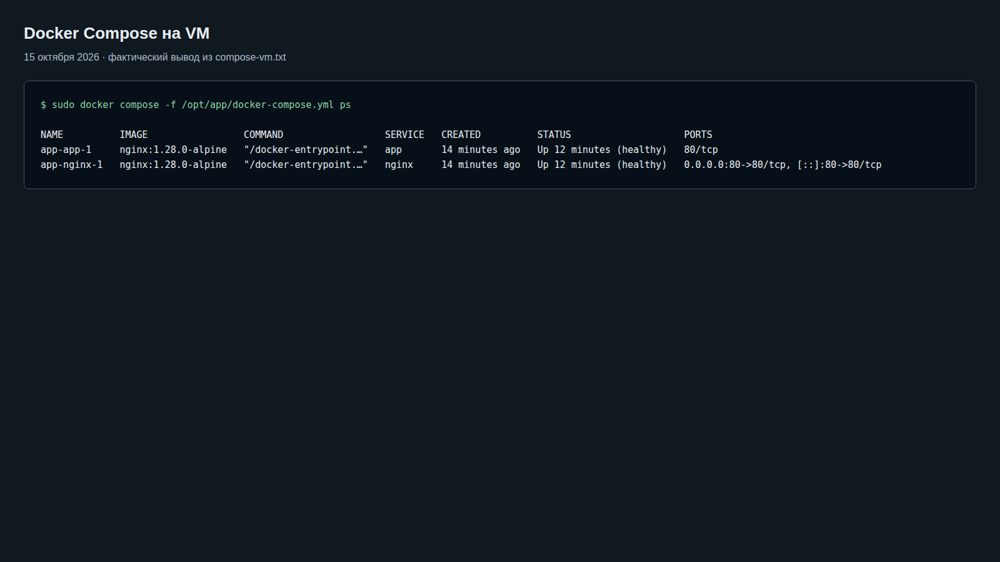

# Фундамент DevOps-инфраструктуры

Решение учитывает дополнение преподавателя: **сначала Ansible, затем Terraform с провайдером `kreuzwerker/docker`**. Основной `terraform/main.tf` создаёт отдельный nginx, новую Docker-сеть и именованный том; nginx доступен через HTTP на нестандартном порту 8080. Остальные контейнеры Compose работают в своей сети.

## Архитектура



| Компонент | Реализация |
|---|---|
| Docker-хост | Уже настроенная локальная Ubuntu 22.04 VM, `172.28.77.10` |
| Ansible | deployer, sudo, Docker Engine/Compose, автозапуск, firewall, мониторинг |
| Terraform | `docker_image`, `docker_network`, `docker_volume`, `docker_container` |
| Новый nginx | `terraform-nginx`, `172.28.77.10:8080 → 80`, штатная страница nginx |
| Том | `terraform-nginx-html → /usr/share/nginx/html`, read-only в контейнере |
| Новая сеть | Только `terraform-nginx` в `terraform-nginx-net` |
| Compose | nginx reverse proxy → app в `app_app_net`, внешний порт 80 |
| Проверка | `curl -i http://172.28.77.10:8080/` должен вернуть `HTTP/1.1 200 OK` |

Первое монтирование именованного тома копирует в него штатные HTML-файлы образа nginx. Жизненный цикл тома управляется отдельным ресурсом Terraform. `keep_locally=true` у образа сохраняет его локально при удалении Terraform-ресурса: такой же образ используют Compose-сервисы.

Docker provider работает через SSH под `deployer`; Docker API не открывается на TCP-порту 2375. SSH проверяет сохранённый ключ хоста. Членство в группе docker даёт административный доступ к Docker-хосту; это доверенная учебная учётная запись, у которой по исходному заданию также есть sudo без пароля. Root login и парольный SSH отключены.

## Структура

```text
terraform/       основной main.tf: Docker provider, nginx, сеть, том
ansible/         inventory, setup_host.yml, роли host/app
compose/         отдельное окружение nginx → app
scripts/         мониторинг и сбор результатов
vm/              необязательная подготовка локальной VM через libvirt
tests/          тесты мониторинга и отрицательная проверка firewall
evidence/       реальные текстовые результаты и изображения вывода
.local/          ключи, образ VM и инструменты; исключено из Git
```

Каталог `vm/` сохранён от первоначальной реализации как вспомогательная инфраструктура. Он не заменяет требуемую часть с Docker provider. При переносе каталогов state существующей VM сохранён отдельно; VM и её данные не пересоздавались из-за переноса. Для основной части ДЗ достаточно готового Ubuntu-хоста с SSH.

## Требования

- Ubuntu 22.04 на целевом хосте; bootstrap-пользователь с SSH-ключом и sudo.
- Terraform 1.13.4 и Ansible Core 2.19.3 на контроллере.
- Python 3.11+, Git и SSH. Terraform: [официальный дистрибутив](https://releases.hashicorp.com/terraform/1.13.4/).
- Для необязательного `vm/`: KVM/libvirt и xsltproc на контроллере.

```bash
python3 -m venv .local/venv
.local/venv/bin/pip install -r requirements.txt
export PATH="$PWD/.local/bin:$PWD/.local/venv/bin:$PATH"
```

В текущем рабочем каталоге инструменты уже находятся в `.local/bin` и `.local/venv`. На другом компьютере установите Terraform отдельно, проверив SHA256SUMS.

## 1. Ansible: сначала настроить хост

Для нового клона создайте отдельный ключ и inventory; укажите адрес и bootstrap-пользователя своего хоста. Этот ключ должен быть разрешён для bootstrap-пользователя на хосте. В действующем стенде ключ и inventory уже подготовлены.

```bash
mkdir -p .local
chmod 700 .local
ssh-keygen -t ed25519 -N '' -C devops-homework -f .local/id_ed25519
cp ansible/inventory.ini.example ansible/inventory.ini
```

Перед подключением проверьте ключ SSH-хоста. Inventory действующего стенда использует TOFU `accept-new` при первом соединении; изменившийся ключ автоматически не принимается. Для нового хоста можно сначала выполнить обычное SSH-подключение и сверить fingerprint.

Адрес контроллера в виртуальной сети и порт дополнительного nginx задаются в `ansible/group_vars/all.yml`. В действующем стенде это `172.28.77.1` и `8080`. При смене порта синхронно измените значение в Terraform.

```bash
set -o pipefail
cd ansible
ansible-playbook setup_host.yml | tee ../evidence/ansible-docker-first.txt
ansible-playbook setup_host.yml | tee ../evidence/ansible-docker-second.txt
cd ..
```

Второй запуск должен иметь `changed=0 failed=0 unreachable=0`. Ansible устанавливает Docker, добавляет deployer в группу docker для Docker provider по SSH, настраивает оба Compose-сервиса и проверяет Hello World через reverse proxy.

Firewall разрешает SSH/HTTP 80/8080 только с адреса контроллера. Фильтрация forwarding ограничивает также опубликованные Docker-порты. Обновление правил изменяет только таблицу `inet homework`, не удаляя таблицы Docker. Файл проверяется `nft --check` перед применением; служба nftables включена при загрузке.

## 2. Terraform: затем создать отдельный nginx

Для нового клона заполните `terraform/terraform.tfvars` по примеру. В текущем стенде уже есть игнорируемый `terraform.tfvars.json`; используйте один файл пользовательских значений, чтобы не получить неожиданный приоритет переменных.

```bash
cp terraform/terraform.tfvars.example terraform/terraform.tfvars
terraform -chdir=terraform init
terraform -chdir=terraform fmt -check
terraform -chdir=terraform validate
terraform -chdir=terraform plan -out=infra.tfplan
terraform -chdir=terraform apply infra.tfplan
curl -i http://172.28.77.10:8080/
terraform -chdir=terraform plan -detailed-exitcode
```

Docker provider закреплён на версии 4.6.0; lock-файл хранится в Git. План создаёт четыре Docker-ресурса. Повторный plan должен показать `No changes`, код завершения 0. Сеть и том создаются Terraform, а не внешними ручными командами.

Параметры по умолчанию подходят для Docker на контроллере через Unix socket с публикацией на 127.0.0.1. Пример tfvars настраивает SSH к учебной VM и публикацию на её адресе. `http_port` допускает только целый порт 1024–65535.

## Проверки и материалы сдачи

```bash
./scripts/collect-evidence.sh
python3 -m unittest discover -s tests -v
ssh -i .local/id_ed25519 deployer@172.28.77.10 'sudo bash -s' < tests/check-firewall.sh
```

Сборщик результатов рассчитан на действующий SSH-стенд. Он сохраняет state Docker-ресурсов, мониторинг, Compose ps, HTTP-ответы обоих окружений и выбранные поля docker inspect: сети, тома, порты и health. В `docker-isolation.json` видно, что Terraform-nginx подключён только к новой сети, а Compose-сервисы — к своей.

Отрицательный тест создаёт временный network namespace внутри гостя с адресом `172.29.88.2` и интерфейсом `ens-hwtest`. Он проверяет запрет SSH, HTTP 80 и HTTP 8080 от другого источника, затем удаляет namespace и интерфейс. Это тест правил гостя на смоделированном внешнем интерфейсе, а не тест из интернета.

Результаты: [evidence/STATUS.md](evidence/STATUS.md). Ниже — скриншоты страниц с фактическим сохранённым выводом команд; это оформленные логи, а не снимки GUI-терминала. Полные `.txt` и JSON доступны рядом.











## Bash-мониторинг

```bash
./scripts/monitor.sh snap.docker.dockerd
ssh -i .local/id_ed25519 deployer@172.28.77.10 'sudo monitor.sh docker'
```

Скрипт проверяет существование unit и `systemctl is-active`; при неактивном сервисе запрашивает последние 10 строк journal. `awk` отбирает syslog за последние 3600 секунд; `grep` считает строки с признаками ошибок без учёта регистра. Поддерживаются традиционный syslog timestamp с переходом года и ISO 8601 с часовым поясом.

Коды завершения: 0 — активная служба и доступный журнал, 1 — неактивная служба, 2 — ошибка аргументов/команд, отсутствующая служба или недоступный журнал. Пустой читаемый журнал даёт ноль. `SYSLOG_FILE` задаёт другой путь для тестов. Считаются строки, а не повторения слова; архивы ротации не просматриваются. Наличие прошлых ошибок в журнале не означает, что Docker сейчас неактивен.

## Необязательная подготовка VM

Выполняется только если готового Ubuntu-хоста ещё нет. На контроллере нужны `qemu-kvm`, `libvirt-daemon-system`, `libvirt-clients`, `dnsmasq-base`, `genisoimage`, `xsltproc` и права пользователя в libvirt/kvm. Установка системных пакетов требует согласия владельца компьютера.

```bash
./scripts/prepare-inputs.sh
terraform -chdir=vm init
terraform -chdir=vm plan -out=infra.tfplan
terraform -chdir=vm apply infra.tfplan
./scripts/create-inventory.sh
```

После этого выполняются основные этапы: Ansible → Terraform Docker. VM: Ubuntu 22.04, 1 vCPU, 1536 MiB RAM, qcow2 до 12 GiB, NAT `172.28.77.0/24`, адрес `.10`. VM не включена в автозапуск компьютера. Скрипт проверяет SHA-256 образа из официального SHA256SUMS; это проверка загрузки, а не независимая проверка подписи производителя.

KVM/libvirt используется только как локальная среда выполнения, основной Terraform-код соответствует дополнению о Docker provider. Исторический облачный IAM из PDF здесь не создаётся. Группа libvirt предоставляет широкие права на локальный гипервизор и не является облачной ролью с правами только на одну VM.

## Проблемы и решения

- Первоначальное подключение libvirt volume блокировалось AppArmor. В `vm/disk-format.xsl` оно преобразуется в путь к файлу с сохранением qcow2; AppArmor не отключался, повторный plan VM не содержит изменений.
- Проблема связи контейнеров Docker Snap на контроллере не затрагивает Docker Engine внутри VM; конфигурация firewall контроллера не менялась.
- В журнале остались временные ошибки параллельной первой загрузки слоёв образа. Образы загрузились, контейнеры healthy; монитор честно считает эти строки в часовом окне.
- Старая ошибка openvpn-dco/обновления ядра контроллера не исправлялась в рамках ДЗ.
- Закреплённый libvirt provider 0.8.3 предупреждает об устаревшем pool.path; это касается только необязательного каталога vm/.

## Git и состояние

Первоначальная работа: `feature/infra-setup` → [PR #1](https://github.com/Topperoo/devops-infrastructure/pull/1), тег `v0.1.0`. Дополнение преподавателя выполнено в `feature/terraform-docker`; новая версия — `v0.2.0`.

State основной Docker-конфигурации и вспомогательной VM раздельны. Не удаляйте state: он связывает код с созданными ресурсами. State, планы, tfvars, приватные ключи и образы дисков исключены из Git. Для одного оператора используется локальный backend; резервную копию state храните отдельно от репозитория.

Репозиторий публичный: преподаватель может открыть код и результаты без приглашения. Само-ревью и фактические проверки перечислены в evidence/STATUS.md.

## Остановка и удаление

- Удалить только дополнительный nginx, его сеть и том с данными: `terraform -chdir=terraform destroy`. Compose и VM сохранятся.
- Остановить Compose: `ssh -i .local/id_ed25519 deployer@172.28.77.10 'docker compose -f /opt/app/docker-compose.yml stop'`.
- Остановить VM с сохранением диска: `virsh -c qemu:///system shutdown devops-homework`.
- Удалить VM вместе с её дисками после сдачи: `terraform -chdir=vm destroy`.

## Источники

- [Docker provider](https://github.com/kreuzwerker/terraform-provider-docker)
- [Документация kreuzwerker/docker](https://registry.terraform.io/providers/kreuzwerker/docker/4.6.0/docs)
- [Docker Engine на Ubuntu](https://docs.docker.com/engine/install/ubuntu/)
- [Docker и firewall](https://docs.docker.com/engine/network/packet-filtering-firewalls/)
