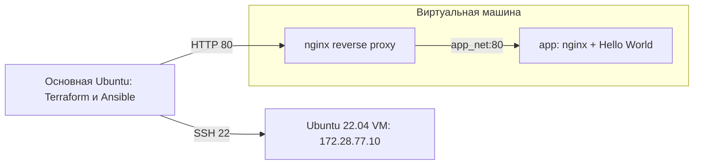

# Фундамент DevOps-инфраструктуры

Локальная Ubuntu 22.04 VM: Terraform создаёт сеть, диски и машину; Ansible настраивает Docker и пользователя `deployer`; nginx проксирует запросы к контейнеру `app` со страницей Hello World.

**Статус:** код подготовлен, Terraform validate, Ansible syntax-check и тесты мониторинга пройдены. Реальное создание VM и второй запуск Ansible ещё не выполнены: на контроллере требуется установка KVM/libvirt с правами администратора. Подтверждение полного выполнения появится в `evidence/` после развёртывания.

## Архитектура



- KVM/libvirt, NAT-сеть `172.28.77.0/24`, адрес контроллера `172.28.77.1`.
- Одна VM: 1 vCPU, 1536 MiB RAM, qcow2-диск до 12 GiB; VM не стартует автоматически при загрузке компьютера.
- Отдельный SSH-ключ проекта, парольный SSH и root login отключены.
- nftables разрешает входящие SSH и HTTP только с адреса контроллера. HTTP нужен для проверки `curl`; это обоснованное дополнение к требованию «только SSH».
- В цепочке forwarding ограничен также трафик к опубликованным Docker-портам: одного INPUT-фильтра для Docker недостаточно. Исходящие соединения контейнеров и ответы разрешены.
- `app` не публикует порт на VM; доступ к нему идёт через `nginx` и отдельную Docker-сеть.
- `deployer` получает sudo без пароля по прямому требованию задания. Это административная учётная запись; членство в группе docker не выдаётся.

## Отличия локального варианта от облачного

PDF допускает локальную инфраструктуру и называет VirtualBox/Proxmox. Здесь используется другой локальный гипервизор — KVM/libvirt. Соответствие этому выбору следует согласовать с преподавателем; облачный IAM в проекте не создаётся.

| Требование | Локальная реализация |
|---|---|
| VPC/Subnet | Управляемая Terraform виртуальная NAT-сеть libvirt |
| Ubuntu VM | Управляемые Terraform domain, qcow2-диски и cloud-init |
| Security Group | nftables в VM, включая фильтрацию Docker forwarding |
| IAM | Облачного эквивалента нет; SSH-ключи и Unix-пользователи управляют доступом к гостю |

Членство контроллера в группе `libvirt` предоставляет широкие права управления локальными VM и не является аналогом облачной роли с правами только на одну VM. Административный bootstrap-пользователь `ubuntu` нужен для Ansible; `deployer` создаётся самим playbook. Требование sudo без пароля ограничивает возможность считать права deployer минимальными.

## Структура

```text
terraform/       сеть, VM, диски, cloud-init, переменные и outputs
ansible/         inventory и роли host/app
compose/         два сервиса, nginx.conf и HTML
scripts/         подготовка inputs, inventory, мониторинг, сбор результатов
tests/           проверки мониторинга
evidence/        фактические результаты проверок
.local/          локальные ключи, образ, инструменты; исключено из Git
```

## Подготовка контроллера

Нужна Linux-машина с аппаратной виртуализацией. Установите системные компоненты с разрешения владельца компьютера:

```bash
sudo apt-get update
sudo apt-get install -y qemu-kvm libvirt-daemon-system libvirt-clients dnsmasq-base genisoimage python3-venv
sudo usermod -aG libvirt,kvm "$USER"
```

Перезайдите в сеанс, чтобы обновились группы. Проверьте `virsh -c qemu:///system list --all` и доступ к `/dev/kvm`. Не отключайте AppArmor и не выдавайте всем доступ к сокету libvirt для устранения ошибок прав.

Нужны Terraform 1.13.4 и Python 3.11+ с Ansible Core 2.19.3. Terraform установите из [официального дистрибутива](https://releases.hashicorp.com/terraform/1.13.4/) с проверкой SHA256SUMS. В текущем рабочем каталоге инструменты уже подготовлены в `.local/bin` и `.local/venv`.

```bash
python3 -m venv .local/venv
.local/venv/bin/pip install -r requirements.txt
export PATH="$PWD/.local/bin:$PWD/.local/venv/bin:$PATH"
./scripts/prepare-inputs.sh
```

Если Terraform установлен глобально, `.local/bin` не требуется. Скрипт скачивает официальный Ubuntu 22.04 cloud image, проверяет SHA-256 и создаёт отдельный SSH-ключ. Сверка контрольной суммы из того же HTTPS-источника выявляет повреждение загрузки, но не заменяет независимую проверку подписи производителя. Локальные значения находятся в игнорируемом `terraform/terraform.tfvars.json`; пример переменных — `terraform/terraform.tfvars.example`. Проверьте отсутствие пересечения подсети с вашими маршрутами.

## Развёртывание

Из корня проекта:

```bash
set -o pipefail
terraform -chdir=terraform init
terraform -chdir=terraform fmt -check
terraform -chdir=terraform validate
terraform -chdir=terraform plan -out=infra.tfplan
terraform -chdir=terraform apply infra.tfplan
./scripts/create-inventory.sh
cd ansible
ansible-playbook setup_host.yml | tee ../evidence/ansible-first.txt
ansible-playbook setup_host.yml | tee ../evidence/ansible-second.txt
cd ..
./scripts/collect-evidence.sh
```

Скрипт inventory ждёт завершения cloud-init. Если SSH ещё не поднялся, повторите его после загрузки VM. Используется SSH TOFU (`accept-new`): новый ключ хоста принимается при первом соединении, сменившийся ключ автоматически не принимается.

Второй Ansible-запуск должен завершиться с `changed=0 failed=0 unreachable=0`. Смена конфигурации приложения вызывает `docker compose up -d --wait`; остановленные сервисы также запускаются повторно. Docker запускается при загрузке гостя, контейнеры используют `restart: unless-stopped`.

Terraform state и план остаются локально, исключены из Git и могут содержать служебные данные. Не удаляйте state: Terraform потеряет связь между кодом и созданными ресурсами. Для учебной работы одного оператора используется локальный backend; резервную копию state храните отдельно от репозитория.

## Мониторинг

```bash
./scripts/monitor.sh snap.docker.dockerd  # Docker Snap на текущем контроллере
ssh -i .local/id_ed25519 deployer@172.28.77.10 'sudo monitor.sh docker'
python3 -m unittest discover -s tests -v
```

Скрипт проверяет существование unit и `systemctl is-active`; при неактивном сервисе запрашивает последние 10 строк journal. `awk` отбирает записи syslog за последние 3600 секунд, `grep` считает строки с признаками ошибок без учёта регистра. Поддерживаются традиционные timestamps syslog и ISO 8601 с часовым поясом. Для традиционного формата учитывается переход года. Пустой читаемый журнал даёт ноль; отсутствующий журнал — ошибку. Учитывается только текущий файл syslog: при ротации часть записей часа может оказаться в архиве.

Коды завершения: `0` — сервис активен и журнал прочитан; `1` — сервис неактивен; `2` — ошибка аргументов, отсутствующая служба/команда либо недоступный журнал. `SYSLOG_FILE` позволяет указать другой путь к syslog, в том числе при тестировании. Считаются строки, а не количество повторений слова error внутри строки.

## Проверки и материалы для сдачи

Подтверждённые локальные проверки перечислены в [evidence/STATUS.md](evidence/STATUS.md). Локальный тест Compose использует временный порт `127.0.0.1:18080`, чтобы не занимать HTTP-порт рабочей машины; это не заменяет проверку на VM.

После развёртывания добавьте в README реальные скриншоты:

1. `terraform -chdir=terraform state list`.
2. Второй запуск Ansible с `changed=0`.
3. `monitor.sh docker` внутри VM.
4. `sudo docker compose -f /opt/app/docker-compose.yml ps` внутри VM.
5. `curl http://172.28.77.10/` на контроллере.

Текстовые результаты собираются в `evidence/`. До появления этих результатов работа не считается полностью выполненной. Для проверки firewall нужен также отрицательный тест с другого источника; ограничение по конфигурации само по себе не является результатом такого теста.

## Git workflow

Рабочая ветка — `feature/infra-setup`, целевая — `main`. После проверки создаётся PR, проводится само-ревью. После завершения проверок и слияния:

```bash
git switch main
git pull --ff-only
git tag -a v0.1.0 -m 'Initial local DevOps infrastructure'
git push origin v0.1.0
```

Приватный репозиторий потребует доступа преподавателя. Секреты, образ Ubuntu, Terraform state и приватный SSH-ключ в Git не добавляются.

## Остановка и удаление

Остановить VM, сохранив диск: `virsh -c qemu:///system shutdown devops-homework`.

Полностью удалить только ресурсы проекта после сдачи: `terraform -chdir=terraform destroy`. Эта команда удалит VM и её данные; установленный на контроллере libvirt останется.

## Источники

- [Terraform libvirt provider 0.8.3](https://github.com/dmacvicar/terraform-provider-libvirt/tree/v0.8.3)
- [Docker Engine на Ubuntu](https://docs.docker.com/engine/install/ubuntu/)
- [Docker и firewall](https://docs.docker.com/engine/network/packet-filtering-firewalls/)
- [libvirt: управление доступом](https://libvirt.org/acl.html)
